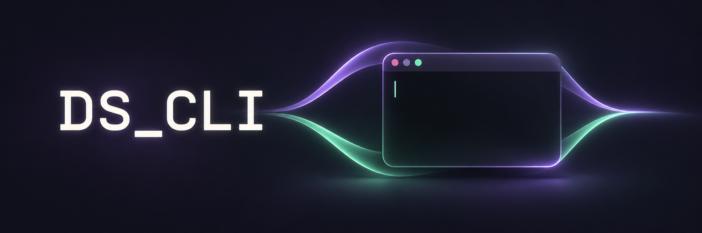

# DS_CLI



English · [简体中文](README.zh.md)

**A coding agent in your terminal, with sessions you can pick up after closing the window.** DS_CLI builds on DeepSeek Harness `0.2.2-rc.5`. Start in a project, choose what the agent can do, and reconnect to the same conversation, jobs, or shell from PowerShell or Git Bash.

[Quick start](#quick-start) · [Everyday commands](#everyday-commands) · [Learn more](#learn-more)

## Quick start

Use Node.js 24.9+ and pnpm 11.7.0. The following commands build this branch from source.

```sh
git clone --branch feature/rc5-terminal-harness https://github.com/Bowen-Xue-ac2/DS_CLI.git
cd DS_CLI
pnpm install --frozen-lockfile
pnpm --dir apps/cli/runtime install --frozen-lockfile
pnpm run build:lib
node apps/cli/lib/bin.js --build-info
node apps/cli/lib/bin.js --choose
```

Set `DEEPSEEK_API_KEY` in the launch environment before starting the Host to use the default DeepSeek provider. In the chooser, use **Tab** to move between workspace, agent, and permissions, **↑ / ↓** to change a selection, and **Enter** to confirm. Start with `read-only` and ask the agent to explain a file.

The examples below use `dsh` for the installed entry point. From a source checkout, use `node apps/cli/lib/bin.js` in its place.

## Everyday commands

| I want to… | Use |
| --- | --- |
| Work in a specific folder | Run `dsh` from a registered project, or use `dsh --choose`. In chat, use `/workspace` to switch projects and `/cd` to change the tool working directory. |
| Continue after closing the terminal | Run `dsh --resume` in the same project. Use `/sessions` to pick a saved conversation and `/jobs` to check work it started. |
| Add context to a request | Type `@` to pick a file or session, `$` to pick a skill, or `@connector:` to choose an available MCP server. Use `/plugins` and `/mcp` to manage extensions. |
| See what the agent did | Open `/activity` for tool calls and timing, `/agents` for delegated work, or `/diff` for the Host’s latest change summary. Set the session’s permissions with `/permission`. |
| Keep a shell running | Open `/terminal new`, choose a shell, and type `~.` to return to chat. Reconnect later with `/terminal`. |

Try typing `@`, selecting `README.md`, and asking **“Explain the startup steps and point out which commands write to disk.”** The input menu stays scoped to the active workspace and agent. Open `/help` in chat for more commands.

## Learn more

- [Interactive CLI guide](docs/user/guide/cli.md) ([中文](docs/user/guide/cli.zh.md)) covers setup, keyboard controls, and session management.
- [Capabilities and platform support](docs/user/guide/cli-capabilities.md) ([中文](docs/user/guide/cli-capabilities.zh.md)) covers MCP, plugins, scheduled jobs, worktrees, and browser handoff.
- [Development guide](docs/development.md) ([中文](docs/development.zh.md)) covers contributing and local checks.

Forked from [DeepSeek Harness](https://github.com/deepseek-ai/deepseek-harness). Licensed under [MIT](LICENSE).

— Bowen 😄🤝
