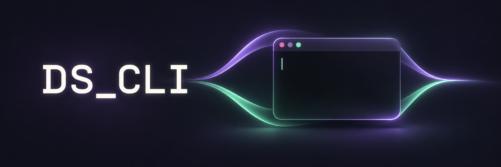

# DS_CLI



[English](README.md) · 简体中文

**在终端里使用编码 Agent，关掉窗口后还可以接着做。** DS_CLI 基于 DeepSeek Harness `0.2.2-rc.5`。在项目中启动，选好 Agent 和权限，就能从 PowerShell 或 Git Bash 接回同一条会话、后台任务或 Shell。

[快速开始](#quick-start) · [常用操作](#everyday-commands) · [文档](#learn-more)

<a id="quick-start"></a>

## 快速开始

使用 Node.js 24.9+ 和 pnpm 11.7.0，从源码构建当前功能分支。

```sh
git clone --branch feature/rc5-terminal-harness https://github.com/Bowen-Xue-ac2/DS_CLI.git
cd DS_CLI
pnpm install --frozen-lockfile
pnpm --dir apps/cli/runtime install --frozen-lockfile
pnpm run build:lib
node apps/cli/lib/bin.js --build-info
node apps/cli/lib/bin.js --choose
```

如使用默认 DeepSeek 提供方，请在启动 Host 前在当前环境中设置 `DEEPSEEK_API_KEY`。在选择器用 **Tab** 切换工作区、Agent 和权限字段，**↑ / ↓** 切选项，**Enter** 确认。第一次可选 `read-only`，发一条理解项目文件的请求。

下表用 `dsh` 表示已安装的入口。在源码目录运行时，可以用 `node apps/cli/lib/bin.js` 替代。

<a id="everyday-commands"></a>

## 常用操作

| 想做什么 | 怎么操作 |
| --- | --- |
| 在指定目录工作 | 进入已登记项目后运行 `dsh`，或用 `dsh --choose` 自选。在聊天里用 `/workspace` 切项目、`/cd` 切工具工作目录。 |
| 关窗后接着做 | 在原项目运行 `dsh --resume`。用 `/sessions` 找会话、`/jobs` 查会话启动的后台任务。 |
| 给请求补充上下文 | 输入 `@` 选文件或会话，输入 `$` 选 Skill，输入 `@connector:` 选可用的 MCP 服务。用 `/plugins` 和 `/mcp` 管理扩展。 |
| 查看 Agent 做了什么 | `/activity` 查看工具调用及耗时，`/agents` 查看委派工作，`/diff` 查看 Host 最近一次改动摘要。用 `/permission` 调整会话权限。 |
| 保持 Shell 运行 | `/terminal new` 选择 Shell，键入 `~.` 返回聊天，之后用 `/terminal` 接回。 |

可以先输入 `@`，选中 `README.md`，再写 **「解释启动步骤，并指出哪些命令会写入磁盘。」** 补全列表随活动工作区和 Agent 变化。在聊天中输入 `/help` 可查看更多命令。

<a id="learn-more"></a>

## 文档

- [交互式 CLI 指南](docs/user/guide/cli.md)（[中文](docs/user/guide/cli.zh.md)）涵盖配置、按键和会话管理。
- [能力与平台支持](docs/user/guide/cli-capabilities.md)（[中文](docs/user/guide/cli-capabilities.zh.md)）涵盖 MCP、插件、定时任务、工作树和浏览器接续。
- [开发指南](docs/development.md)（[中文](docs/development.zh.md)）涵盖贡献流程和本地检查。

本项目 fork 自 [DeepSeek Harness](https://github.com/deepseek-ai/deepseek-harness)，使用 [MIT 许可证](LICENSE)。

— Bowen 😄🤝
